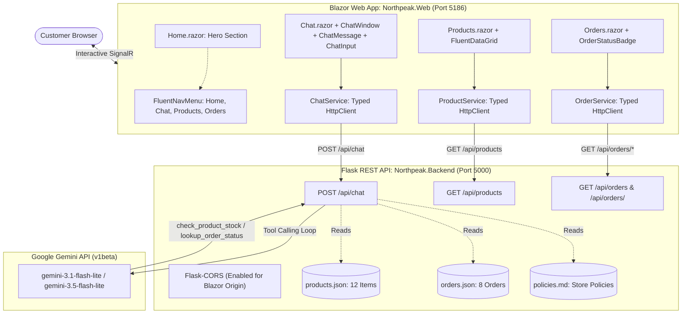

# 🌲 Northpeak Outfitters - Blazor Web App & AI Sales Backend

A modern, production-grade outdoor equipment e-commerce web application featuring an AI sales chatbot, real-time inventory checking, and customer order tracking.

- **Frontend**: Blazor Web App (.NET 8/10, Interactive Server mode) built with **Microsoft Fluent UI Blazor (Fluent 2 Design)**.
- **Backend**: Python Flask REST API with CORS, backed by **Google Gemini API** with native **Function Calling (Tool Calling)**.

---

## 🏛️ Architecture



---

## 📁 Project Structure

```
scratch/
├── Northpeak.Web/                     # Blazor Web App
│   ├── Components/
│   │   ├── Layout/                    # MainLayout.razor(.cs), NavMenu.razor
│   │   ├── Pages/                     # Home.razor(.cs), Chat.razor(.cs), Orders.razor(.cs), Products.razor(.cs)
│   │   ├── Chat/                      # ChatWindow.razor(.cs), ChatMessage.razor(.cs), ChatInput.razor(.cs), TypingIndicator.razor(.cs)
│   │   └── Shared/                    # ProductCard.razor(.cs), OrderStatusBadge.razor(.cs)
│   ├── Models/                        # ChatMessage.cs, ChatRequest.cs, ChatResponse.cs, Order.cs, Product.cs (Records)
│   ├── Services/                      # IChatService.cs, ChatService.cs, IOrderService.cs, OrderService.cs, IProductService.cs, ProductService.cs
│   ├── wwwroot/                       # app.css, js/chat.js
│   ├── Program.cs                     # Typed HttpClients & FluentUI configuration
│   └── appsettings.json               # Backend BaseUrl configuration
│
└── Northpeak.Backend/                 # Flask REST API Backend
    ├── app.py                         # REST API with CORS & Gemini Tool Calling
    ├── products.json                  # 12 outdoor gear products
    ├── orders.json                    # 8 customer orders with statuses and ETAs
    ├── policies.md                    # Returns (30 days), Shipping (free >$50), Warranty (1 yr)
    ├── requirements.txt               # Flask dependencies
    └── .env                           # GEMINI_API_KEY configuration
```

---

## 🔑 Setting the Gemini API Key

Create or edit `Northpeak.Backend/.env`:

```bash
GEMINI_API_KEY="your-gemini-api-key"
# Optional: GEMINI_MODEL="gemini-3.1-flash-lite"
```

*(Note: If `GEMINI_API_KEY` is omitted, the backend runs in simulated demo mode, returning accurate stock and order responses using local in-memory data.)*

---

## 🚀 How to Run Both Applications

### Step 1: Start the Flask Backend (Port 5000)

```bash
cd /Users/botondszabo/.gemini/antigravity/scratch/Northpeak.Backend
# Activate the virtual environment or run with python:
/Users/botondszabo/.gemini/antigravity/scratch/.venv/bin/python app.py
```
*The backend will be running on `http://127.0.0.1:5000` with CORS enabled.*

### Step 2: Start the Blazor Web App (Port 5186)

In a separate terminal:
```bash
cd /Users/botondszabo/.gemini/antigravity/scratch/Northpeak.Web
dotnet run --launch-profile http
```
*The Blazor app will be running on `http://localhost:5186`.*

---

## 🌐 Testing the Features in the Browser

Open **`http://localhost:5186`** in your browser:

### 1. Home Page (`/`)
- Hero section for **Northpeak Outfitters** with direct CTA buttons to Chat, Products, and Orders.

### 2. Products Catalog Page (`/products`)
- Full interactive `FluentDataGrid` displaying the 12 outdoor gear items.
- Live stock badges: Green for items in stock (`14 in stock`), Red for items out of stock (`Out of stock`).
- Real-time search filter input to quickly search by product name, category, or ID.

### 3. Orders Page (`/orders`)
- Order lookup input with quick-select sample buttons (`ORD-1001`, `ORD-1002`, `ORD-1003`).
- Displays customer name, carrier, tracking number, estimated arrival (ETA), itemized breakdown, total, and colored `OrderStatusBadge`.

### 4. AI Gear Chat Page (`/chat`)
- Interactive chat window with user messages on the right and assistant on the left.
- Enter key submission, input disabling, and animated typing indicator while waiting.
- Tool invocation badges display when Gemini function calling (`check_product_stock` or `lookup_order_status`) executes.
- Try demo prompts using the one-click quick-prompt buttons:
  - *"Is the Apex 2-Person Ultralight Tent in stock?"* (checks inventory tool)
  - *"What is the status of order ORD-1001?"* (checks order tracking tool)
  - *"What is your return policy and warranty?"* (answers from store policies)
